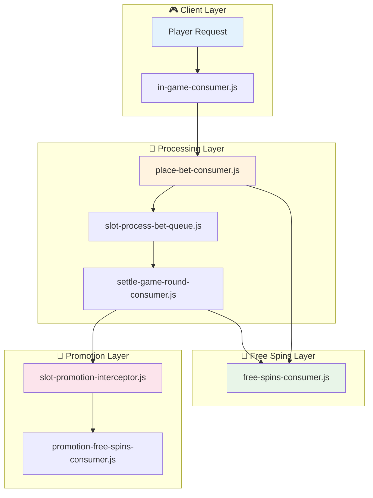
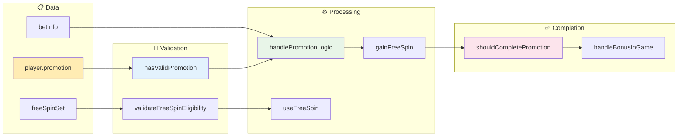
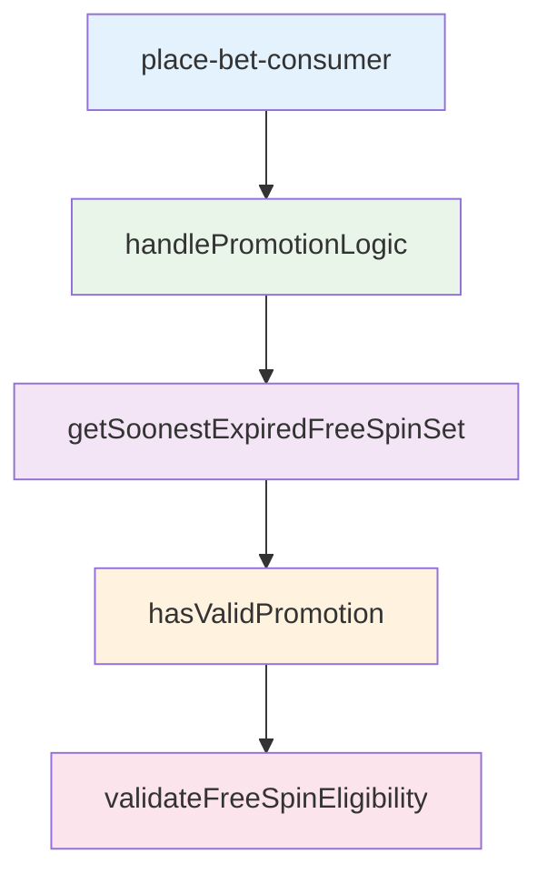
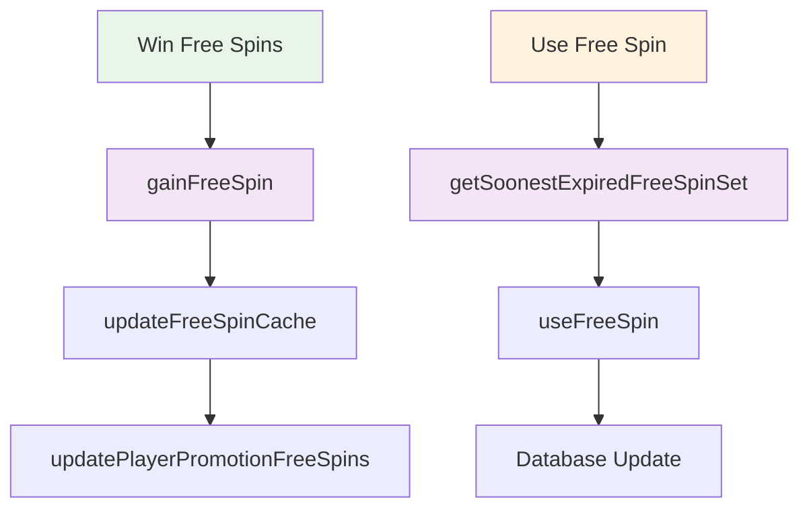
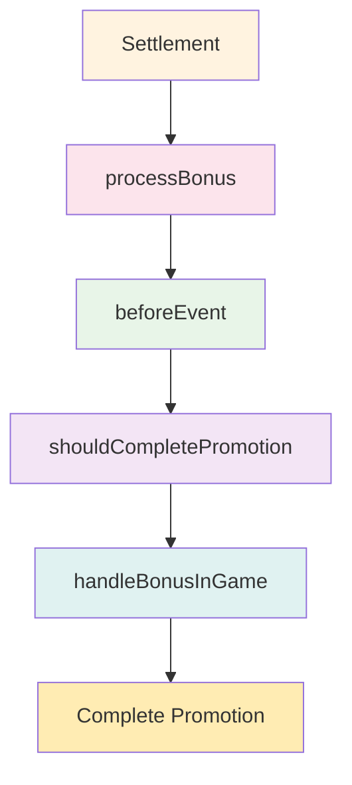

# Promotion System - Component Interactions

This document shows how components interact in the promotion system, organized by functional layers for better clarity.

## 🏗️ System Architecture Overview



## 📊 Core Data Flow



## 🔄 Key Function Interactions

### Bet Processing Flow


### Free Spin Lifecycle


### Promotion Completion


## 🏗️ Layer Responsibilities

### 🎮 Client Layer
- **in-game-consumer.js**: Handles player requests and builds game payload
- **Purpose**: Interface between player and game system
- **Key Functions**: `buildPayload()`, `getAvailableFreeSpins()`

### 🎯 Processing Layer  
- **place-bet-consumer.js**: Validates and processes bet placement
- **slot-process-bet-queue.js**: Manages bet queue and promotion validation
- **settle-game-round-consumer.js**: Orchestrates game settlement
- **Purpose**: Core game logic and bet processing

### 🎁 Promotion Layer
- **slot-promotion-interceptor.js**: Manages promotion lifecycle
- **promotion-free-spins-consumer.js**: Handles promotion-specific bonuses
- **Purpose**: Promotion-specific logic and completion

### 💫 Free Spins Layer
- **free-spins-consumer.js**: Complete free spin lifecycle management
- **Purpose**: Free spin creation, usage, and expiry management

## 🔄 Key Interaction Patterns

### 1. **Top-Down Flow**
```
Player Request → Client Layer → Processing Layer → Promotion/Free Spins
```

### 2. **Data-Driven Validation**
```
Data Structures → Validation Functions → Processing Logic → Completion Check
```

### 3. **Cross-Layer Communication**
- **Processing ↔ Free Spins**: Bet processing triggers free spin usage/creation
- **Processing ↔ Promotion**: Settlement triggers promotion logic
- **Client ↔ Free Spins**: Client queries free spin availability

## 📊 Core Data Structures

```javascript
// Central promotion data
player.promotion = {
    promotionId: string,
    isClaimed: boolean,
    freeSpinAvailable: number,
    bonus: number,
    remainingBonusItems: number,
    endDate: Date
}

// Free spin set information  
freeSpinSet = {
    id: number,
    promotionId: string | null,
    available: number,
    expiryTime: Date,
    bet: number,
    paylines: array
}

// Bet information
betInfo = {
    freeSpin: boolean,
    amount: number,
    betChoice: array,
    totalAmount: number
}
```

## 🎯 Design Benefits

✅ **Clear Separation**: Each layer has distinct responsibilities  
✅ **Easy to Follow**: Linear flows instead of complex interconnections  
✅ **Maintainable**: Changes in one layer have minimal impact on others  
✅ **Testable**: Each flow can be tested independently 