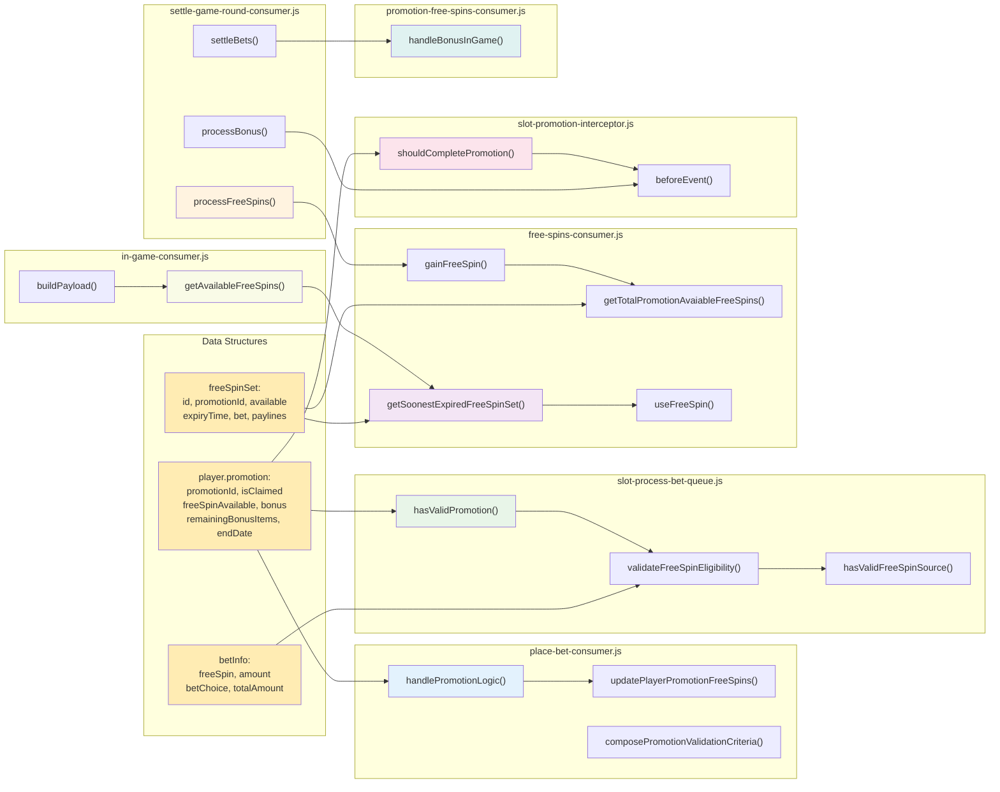

# Promotion System - Component Interactions

This diagram illustrates how data structures and methods in each component interact with each other in the promotion system.

## Component Responsibilities:

### 📊 Data Structures (Yellow)
- **player.promotion**: Contains player's promotion information
- **freeSpinSet**: Detailed information about free spin sets
- **betInfo**: Information about current bet

### 🔵 place-bet-consumer.js (Blue)
- **handlePromotionLogic()**: Handles promotion logic when player places bet
- **updatePlayerPromotionFreeSpins()**: Updates promotion free spins count
- **composePromotionValidationCriteria()**: Creates criteria to validate promotion

### 🟢 slot-process-bet-queue.js (Green)
- **hasValidPromotion()**: Checks if promotion is valid
- **validateFreeSpinEligibility()**: Validates free spin eligibility
- **hasValidFreeSpinSource()**: Checks free spin source

### 🟣 free-spins-consumer.js (Purple)
- **getSoonestExpiredFreeSpinSet()**: Gets the soonest expiring free spin set
- **getTotalPromotionAvaiableFreeSpins()**: Calculates total promotion free spins
- **useFreeSpin()**: Uses one free spin
- **gainFreeSpin()**: Creates new free spin

### 🟠 settle-game-round-consumer.js (Orange)
- **processFreeSpins()**: Processes free spins from game results
- **processBonus()**: Processes bonus
- **settleBets()**: Settles bets

### 🔴 slot-promotion-interceptor.js (Red)
- **shouldCompletePromotion()**: Checks promotion completion conditions
- **beforeEvent()**: Handles processing before event occurs

### 🟢 promotion-free-spins-consumer.js (Light Green)
- **handleBonusInGame()**: Handles in-game bonus for promotion

### 🟤 in-game-consumer.js (Brown)
- **getAvailableFreeSpins()**: Gets available free spins information
- **buildPayload()**: Creates payload to send to client

## Data Flow Patterns:

1. **Validation Chain**: A → G → H → I
2. **Free Spin Management**: B → J → L → M → K
3. **Settlement Processing**: N → M → O → R → P → S
4. **Client Communication**: U → T → J

## Key Integration Points:

- **player.promotion** is the central data structure used by multiple components
- **free-spins-consumer.js** is the core component managing free spins
- **slot-promotion-interceptor.js** coordinates promotion lifecycle
- **settle-game-round-consumer.js** orchestrates the entire settlement process 