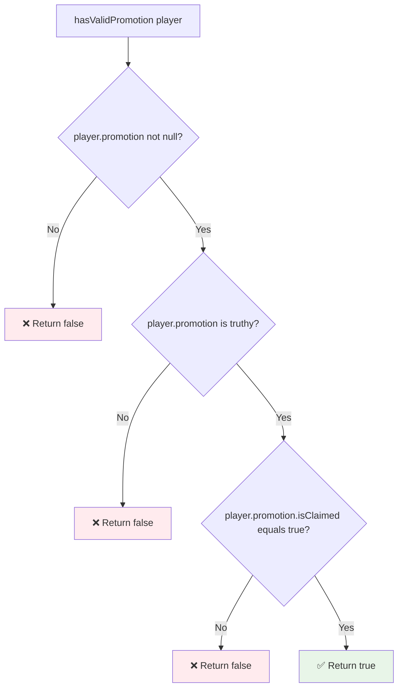
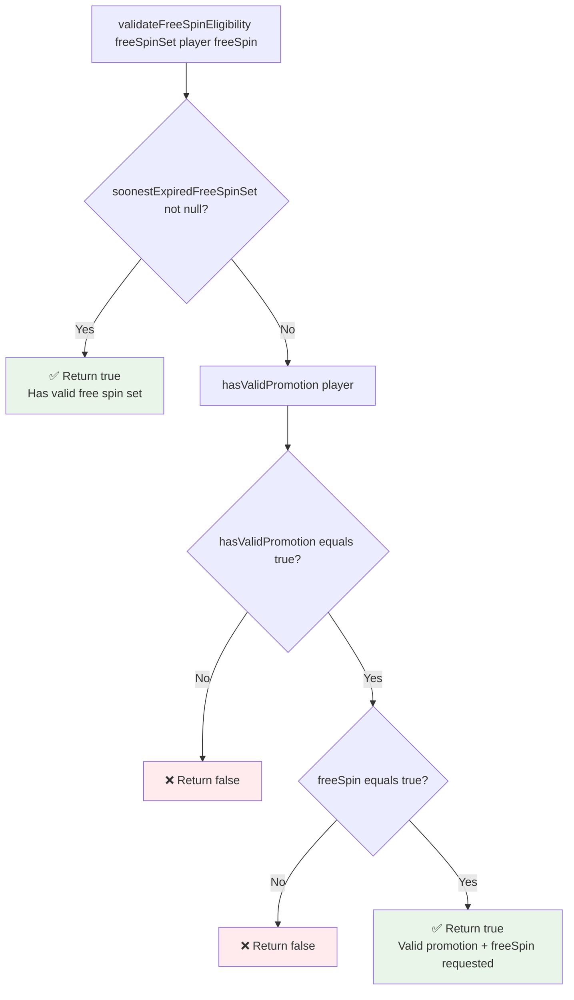
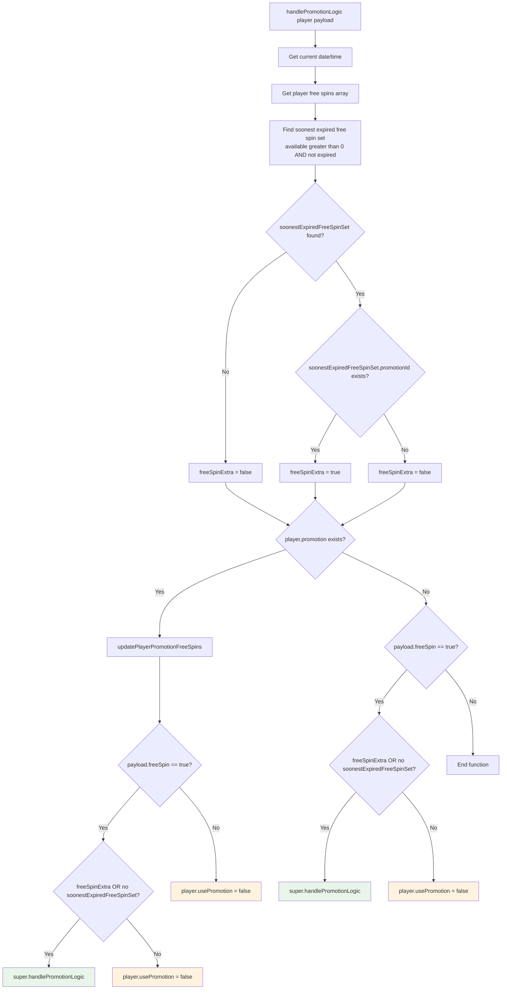
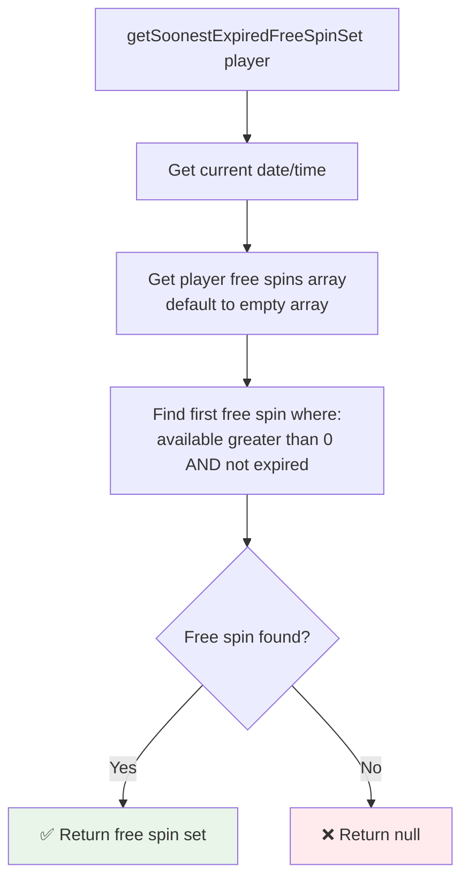
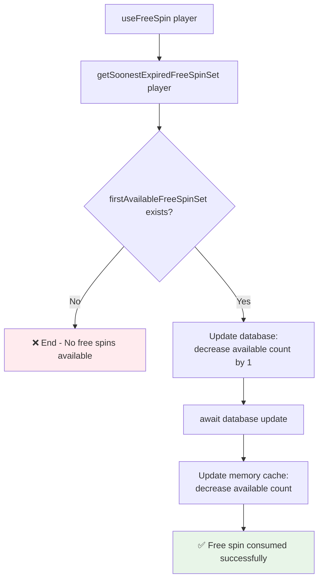
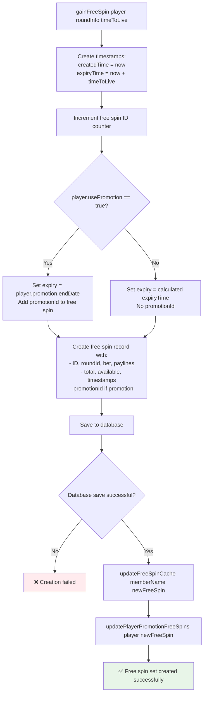
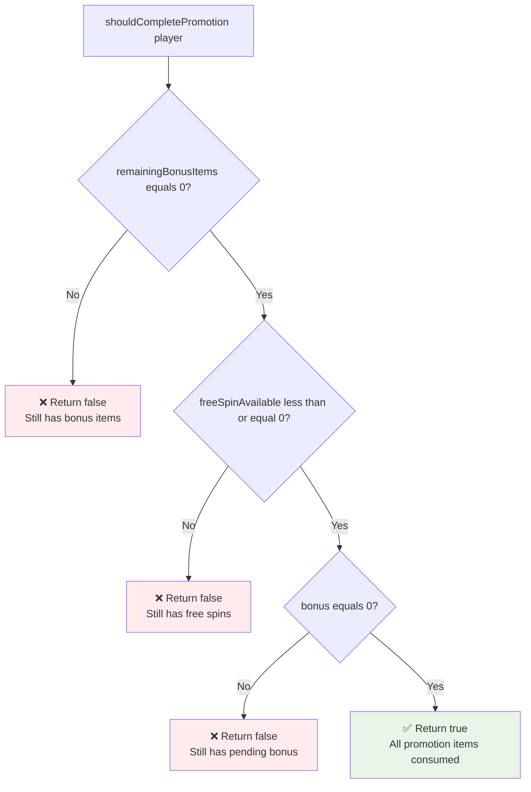
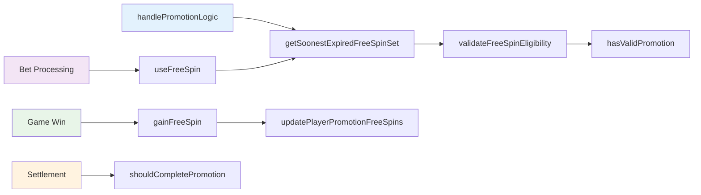

# Promotion System - Detailed Function Logic

This document provides detailed flowcharts for each key function in the promotion system, showing internal logic checks and conditions.

## 📋 Function Index

- [hasValidPromotion()](#hasvalidpromotion)
- [validateFreeSpinEligibility()](#validatefreespineligibility)
- [handlePromotionLogic()](#handlepromotionlogic)
- [getSoonestExpiredFreeSpinSet()](#getsoonestexpiredfreespinset)
- [useFreeSpin()](#usefreespin)
- [gainFreeSpin()](#gainfreespin)
- [shouldCompletePromotion()](#shouldcompletepromotion)

---

## hasValidPromotion()

**Location**: `slot-process-bet-queue.js`  
**Purpose**: Validates if player has a valid promotion

**Logic Checks:**
1. `player.promotion != null` - Promotion object exists
2. `player.promotion` - Promotion is truthy (not false/empty)
3. `player.promotion.isClaimed` - Promotion has been claimed by player

---

## validateFreeSpinEligibility()

**Location**: `slot-process-bet-queue.js`  
**Purpose**: Determines if player is eligible for free spins

**Logic Priority:**
1. **Free Spin Set Available** → Always eligible
2. **No Free Spin Set** → Check promotion + freeSpin flag
3. **Valid Promotion + freeSpin=true** → Eligible
4. **Otherwise** → Not eligible

---

## handlePromotionLogic()

**Location**: `place-bet-consumer.js`  
**Purpose**: Processes promotion logic during bet placement

**Key Logic:**
1. **Find Active Free Spins** - Gets unexpired free spin sets
2. **Detect Promotion Free Spins** - Checks if free spins have promotionId
3. **Update Promotion Data** - Syncs free spin availability
4. **Determine Usage** - Decides whether to use promotion logic

---

## getSoonestExpiredFreeSpinSet()

**Location**: `free-spins-consumer.js`  
**Purpose**: Retrieves the free spin set that will expire soonest

**Search Criteria:**
- `available > 0` - Has remaining spins
- `expiryTime > currentDateTime` - Not expired
- **First match** - Array is sorted by expiry time (soonest first)

---

## useFreeSpin()

**Location**: `free-spins-consumer.js`  
**Purpose**: Consumes one free spin and updates database

**Operations:**
1. **Find Available** - Gets soonest expiring free spin set
2. **Database Update** - Atomic decrement of available count
3. **Cache Update** - Sync memory cache with database
4. **Dual Update** - Ensures consistency between DB and cache

---

## gainFreeSpin()

**Location**: `free-spins-consumer.js`  
**Purpose**: Creates new free spin set when player wins free spins

**Key Features:**
- **Promotion Integration** - Links to active promotion if applicable
- **Expiry Management** - Uses promotion end date or calculated TTL
- **Dual Storage** - Updates both database and memory cache
- **ID Management** - Increments global free spin counter

---

## shouldCompletePromotion()

**Location**: `slot-promotion-interceptor.js`  
**Purpose**: Determines if promotion should be marked as complete

**Completion Criteria (ALL must be true):**
1. `remainingBonusItems === 0` - No bonus items left
2. `freeSpinAvailable <= 0` - No free spins remaining
3. `bonus === 0` - No pending bonus amount

**Logic**: Uses **AND** condition - ALL criteria must be met for completion.

---

## 🔧 Function Interaction Flow

## 🎯 Error Handling Patterns

### Null Checks
- All functions validate input parameters
- Graceful degradation when data is missing
- Default to safe states (false/null returns)

### Database Consistency
- Atomic operations for critical updates
- Cache synchronization after DB operations
- Transaction-like behavior where possible

### State Validation
- Multiple validation layers
- Early returns for invalid states
- Clear error indicators in return values 