# Promotion Logic Main Flow

This diagram illustrates the main flow of promotion logic from when a player places a bet until the bet settlement.

```mermaid
flowchart TD
    A["Player Places Bet"] --> B["place-bet-consumer.js consume()"]
    B --> C{"Check promotion handlePromotionLogic()"}
    
    C --> D["Update player promotion free spins count"]
    D --> E["Add to bet queue"]
    E --> F["slot-process-bet-queue.js proceedBet()"]
    
    F --> G{"Check if game finished"}
    G -->|Yes| H["Publish failed bet"]
    G -->|No| I["Get soonest expired free spin set"]
    
    I --> J["Validate free spin eligibility"]
    J --> K{"Has valid promotion?"}
    K -->|Yes| L["Set promotion data: freeSpinAvailable, bonus = 0"]
    K -->|No| M["Continue without promotion"]
    
    L --> N{"Valid free spin source?"}
    M --> N
    N -->|No| O["Handle invalid free spin - Publish failed bet"]
    N -->|Yes| P["Generate bet info"]
    
    P --> Q["Increment round ID"]
    Q --> R["Super.proceedBet()"]
    R --> S["Handle success bet"]
    
    S --> T{"Is free spin?"}
    T -->|Yes| U["free-spins-consumer.js useFreeSpin()"]
    T -->|No| V["Calculate currency rate"]
    
    U --> W["Update free spin availability in DB"]
    W --> V
    V --> X["Upsert bet record"]
    X --> Y["settle-game-round-consumer.js settleRound()"]
    
    Y --> Z["Generate round result"]
    Z --> AA["Process free spins from settlement"]
    AA --> BB{"Free spins won?"}
    BB -->|Yes| CC["free-spins-consumer.js gainFreeSpin()"]
    BB -->|No| DD["Continue settlement"]
    
    CC --> EE{"Using promotion?"}
    EE -->|Yes| FF["Set promotion expiry time + Add promotionId"]
    EE -->|No| GG["Set normal expiry time"]
    
    FF --> HH["Update free spin cache"]
    GG --> HH
    HH --> II["Update player promotion free spins"]
    II --> DD
    
    DD --> JJ{"Has jackpot?"}
    JJ -->|Yes| KK["Process jackpot"]
    JJ -->|No| LL["Process bet normally"]
    
    KK --> MM["Process bet after jackpot"]
    LL --> NN{"Has bonus?"}
    MM --> NN
    
    NN -->|Yes| OO["Process bonus - Update promotion bonus"]
    NN -->|No| PP["Settle bets directly"]
    
    OO --> QQ["slot-promotion-interceptor.js beforeEvent()"]
    QQ --> RR{"Free spins available?"}
    RR -->|Yes| SS["Decrease free spin count"]
    RR -->|No| TT["Call super.beforeEvent()"]
    
    SS --> UU["Continue to settlement"]
    TT --> UU
    UU --> PP
    
    PP --> VV["Calculate bet results"]
    VV --> WW{"Has promotion and bonus?"}
    WW -->|Yes| XX["promotion-free-spins-consumer.js handleBonusInGame()"]
    WW -->|No| YY["Complete settlement"]
    
    XX --> ZZ["Update promotion ticket via API"]
    ZZ --> AAA["Reset promotion bonus = 0"]
    AAA --> BBB["slot-promotion-interceptor.js endPromotionEvent()"]
    BBB --> CCC{"Should complete promotion?"}
    CCC -->|Yes| DDD["Complete promotion"]
    CCC -->|No| YY
    
    DDD --> YY
    YY --> EEE["Clean up game data"]
    
    style A fill:#e1f5fe
    style H fill:#ffebee
    style O fill:#ffebee
    style XX fill:#f3e5f5
    style CC fill:#e8f5e8
    style QQ fill:#fff3e0
    style BBB fill:#fff3e0
```

## Main Components:

### 🔵 Entry Point (Blue)
- **Player Places Bet**: Starting point of the flow

### 🔴 Error Handling (Red)  
- **Publish failed bet**: When game has finished or free spin is invalid
- **Handle invalid free spin**: When player attempts to use invalid free spin

### 🟣 Promotion Processing (Purple)
- **promotion-free-spins-consumer.js**: Handles bonus from promotion

### 🟢 Free Spins Management (Green)
- **free-spins-consumer.js**: Manages creation and usage of free spins

### 🟠 Interceptor Logic (Orange)
- **slot-promotion-interceptor.js**: Manages promotion lifecycle

## Key Decision Points:

1. **Promotion Validation**: Check if player has valid promotion
2. **Free Spin Source**: Determine free spin source (from game win or promotion)
3. **Settlement Type**: Decide how to handle results (jackpot, bonus, regular)
4. **Promotion Completion**: Check whether promotion should be completed 