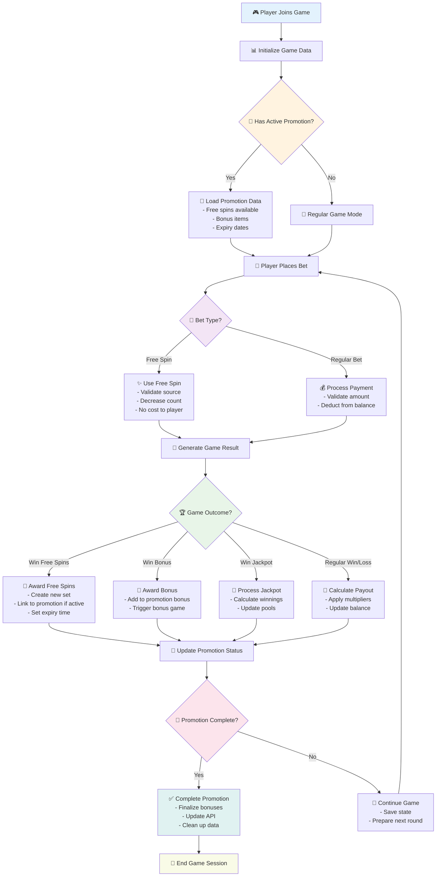

# Promotion System - High-Level Overview

This diagram provides a bird's-eye view of the promotion system, focusing on major phases and key decision points.



## 🎯 System Phases

### 🔵 Initialization Phase (Blue)
- **Game Entry**: Player joins and system initializes
- **Promotion Check**: Determines if player has active promotions
- **Data Loading**: Loads promotion-specific data and settings

### 🟠 Bet Processing Phase (Orange)  
- **Bet Type Detection**: Distinguishes between free spins and regular bets
- **Payment Processing**: Handles different payment scenarios
- **Validation**: Ensures bet is valid and player eligible

### 🟣 Game Execution Phase (Purple)
- **Result Generation**: Creates random game outcomes
- **Outcome Classification**: Categorizes different types of wins
- **Reward Distribution**: Applies appropriate rewards based on outcome

### 🟢 Settlement Phase (Green)
- **Promotion Updates**: Updates promotion status and counters
- **Completion Check**: Determines if promotion should be completed
- **State Management**: Saves game state for next round

## 🎮 Key Decision Points

### 1. **Promotion Status Check**
- Determines game mode (promotion vs regular)
- Loads appropriate configuration and limits
- Sets validation rules for the session

### 2. **Bet Type Validation**
- **Free Spin**: Validates source, checks expiry, decreases count
- **Regular Bet**: Validates amount, checks balance, processes payment

### 3. **Outcome Processing**
- **Free Spins Win**: Creates new free spin sets with promotion context
- **Bonus Win**: Triggers bonus games and updates promotion bonuses
- **Jackpot Win**: Processes large payouts and pool updates
- **Regular Win**: Standard payout calculation and balance update

### 4. **Promotion Completion**
- Checks if all promotion requirements are met
- Automatically completes promotion when conditions satisfied
- Cleans up promotion data and notifies external systems

## 🔄 Flow Characteristics

- **Circular Nature**: Game continues until player exits or promotion completes
- **State Persistence**: All promotion data maintained across rounds
- **Error Recovery**: Failed operations don't break the game flow
- **External Integration**: Promotion system syncs with external APIs

## 📊 Data Flow Summary

```
Player → Game Init → Promotion Check → Bet → Game Result → Settlement → Repeat
```

This high-level view abstracts away implementation details to focus on business logic and user experience flow. 