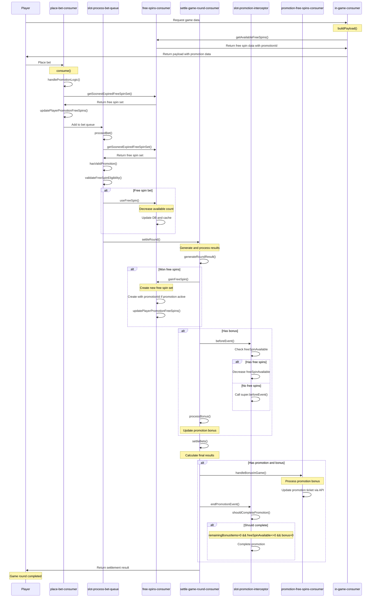

# Promotion Logic - Sequence Diagram

This diagram illustrates the time sequence of activities in a typical betting flow with promotion.

## Sequence Flow Explanation:

### 🎮 Game Initialization Phase
1. **Player requests game data** - InGameConsumer builds payload including promotion info
2. **Free spins data** - Retrieved and included in response with promotionId if applicable

### 🎲 Bet Placement Phase  
3. **Player places bet** - PlaceBetConsumer validates and processes
4. **Promotion logic handling** - Updates promotion free spins count
5. **Queue processing** - Bet added to processing queue

### ⚙️ Bet Processing Phase
6. **Bet validation** - ProcessBetQueue validates promotion and free spin eligibility
7. **Free spin usage** - If free spin bet, decreases available count
8. **Settlement initiation** - Triggers settlement process

### 🎰 Settlement Phase
9. **Result generation** - SettleRoundConsumer generates game results
10. **Free spins processing** - If won free spins, creates new free spin sets with promotion context
11. **Bonus processing** - If bonus won, processes through promotion interceptor

### 🎁 Promotion Bonus Phase
12. **Bonus handling** - PromotionFreeSpinsConsumer updates promotion ticket via API
13. **Promotion completion check** - Determines if promotion should be completed
14. **Final settlement** - Returns results to player

## Key Decision Points:

- **🔍 Promotion Validation**: Multiple validation checks at different stages
- **🎯 Free Spin Source**: Distinguishes between regular and promotion free spins  
- **⚡ Interceptor Logic**: PromotionInterceptor manages promotion lifecycle
- **🏁 Completion Logic**: Auto-completes promotion when conditions met

## Error Handling:

- Invalid promotion states result in failed bets
- API failures in promotion ticket updates are logged but don't block settlement
- Free spin validation prevents unauthorized usage

## Data Synchronization:

- **Cache Updates**: Free spin counts updated in both DB and memory cache
- **Promotion State**: Consistent across all components through shared player object
- **API Integration**: External promotion system kept in sync via API calls 